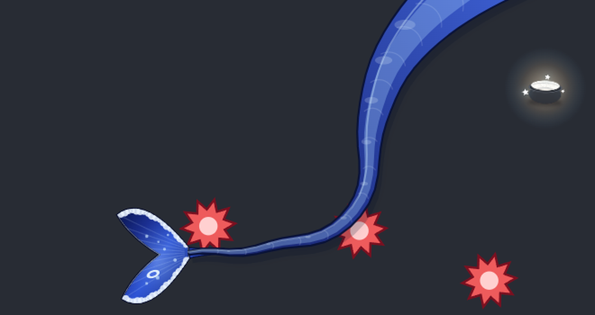
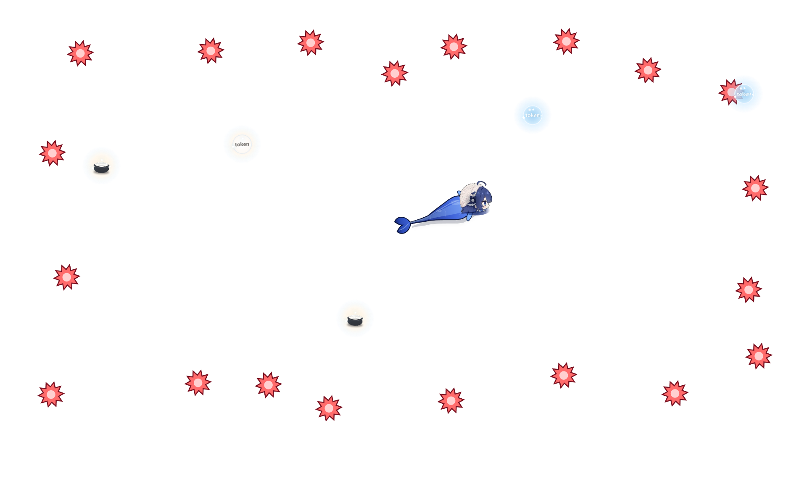

# 鲸鱼娘桌宠贪吃蛇 · Whale Snake Pet

一个住在 Windows 桌面上的透明置顶小游戏。

平时她是右下角打盹的鲸鱼娘；你忙完一阵、动动鼠标，她就变成一条「鲸鱼尾巴的贪吃蛇」追着光标吃 token；你一开始敲键盘工作，她又悄悄变回原形，安静退场。

> 原生透明覆盖层 + 全局只读输入探针。不是网页挂件，不抢焦点、不拦截按键、不记录你按了什么。





## 特性

- **三层判定**：10 秒无输入 → 变蛇漫游；鼠标移动 → 追光标吃 token；连续快速输入（500ms 内两次，或 5 秒内 3 次点击）→ 安静退场并冷却 15 秒。
- **两套收尾**：工作信号 → 缩小滑回角落；撞障碍/撞自己 → 撞晕星星 + 「哎哟！」，2 秒后回原形。
- **只读输入探针**：C# 每 20ms 读 `GetCursorPos` / `GetAsyncKeyState` / `GetLastInputInfo`，只输出「有没有输入」和光标位置，不上报具体键值，不装钩子。
- **四向头部**：正脸 / 左侧脸 / 右侧脸 / 后脑（帽顶），按移动方向选最近锚点 + 平滑插值，转向不跳变。
- **鲸鱼身体**：长度无上限，体型随长度增长；转向角速度随长度从 420°/s 降到 200°/s；尾巴有行进波和偶尔的甩尾，尾鳍带白色蕾丝边、星点与椭圆斑。
- **难度曲线**：开局 6 个障碍，吃满 4 个 token 后每 2 个 +1，上限 20；障碍数 ≥10 时自动收紧生成间距。
- **声音**：吃到 token 时按洗牌袋抽语音（25% 米饭 / 25% token / 50% 静音），撞死时「哎哟！」。语音文件不随仓库分发，见下文。
- **可配置**：托盘 / 右键菜单 / 设置页，能调空闲时长、连击判据、冷却、障碍开关，也能导入自己的 PNG/JPG/GIF/WebP 立绘。
- **可打包**：`npm run pack` 产出免安装的 `dist/WhaleSnakePet/WhaleSnakePet.exe`。

## 快速开始

要求：Windows 10/11 x64、Node.js 20+（开发时用 26 验证）、.NET Framework 4.x（Win10/11 自带，仅用于编译输入探针）。

```bash
git clone <your-repo-url> whale-snake-pet
cd whale-snake-pet
npm install
node node_modules/electron/install.js   # npm 只装包，不会自动下载 Electron 二进制
npm run build:helper                    # 用 csc 编译 bin/input-helper.exe
npm start
```

- 如果启动后没有窗口：先确认环境里没有 `ELECTRON_RUN_AS_NODE=1`（某些 Electron 终端会带），或者直接用 `scripts\start.cmd`。
- 试玩全套状态：`npm run demo`（26 秒自动走完 睡觉 → 漫游 → 追光标 → 撞死 → 收工）。
- 停止常驻：托盘「退出」，或 `powershell -ExecutionPolicy Bypass -File scripts\stop.ps1`。
- 测试：`npm test`（node:test，31 条）。
- 打包：`npm run pack` → `dist\WhaleSnakePet\WhaleSnakePet.exe`（约 360 MB，Electron 全量）。

## 作为 DSH 插件安装

仓库根目录同时是一个 DSH bundle（`package.json` 里的 `dsh.bundle.patch` + `index.mjs`）：

- 在 DSH 的 **插件 → 添加插件** 里选择本仓库目录安装；启用后桌宠随 DSH 启动，停用即关闭。
- 首次启用会从 GitHub Release 下载 `WhaleSnakePet-win-x64.zip`，解压到
  `%LOCALAPPDATA%\dsh-pet-snakegame\app\`（约 360 MB，需要网络）。
- 也可以手动下载同一个 zip 解压，把插件配置里的 `exePath` 指向 `WhaleSnakePet.exe`，
  或设置环境变量 `DSH_PET_EXE`。
- 插件配置：`autoStart`（默认 `true`）、`exePath`（默认空）。

## 怎么玩

| 操作 | 效果 |
| --- | --- |
| 10 秒不动鼠标键盘 | 立绘变成蛇，开始漫游 |
| 移动鼠标 | 蛇头追光标，吃到 token 变长 |
| 光标停住 3 秒 | 小鲸鱼变回原形、生气 1.4 秒，然后继续漫游 |
| 快速连按 / 5 秒内点 3 次 | 安静收工，15 秒内不再自动出现 |
| 光标停在立绘上右键 | 玩一会儿 / 设置 / 退出 |
| 托盘图标 | 同上，另有「输入探针」「障碍」快捷开关 |
| `Ctrl+Alt+S` | 手动开一局 |
| `Ctrl+Alt+Shift+Q` | 退出 |

## 配置

设置页会写 `config.json`（与 exe 同目录；缺失则用默认值）。可调项：

| 键 | 默认 | 说明 |
| --- | --- | --- |
| `inputEnabled` | `true` | 关闭后不启动输入探针，纯桌宠、无工作信号 |
| `rightClickMenu` | `true` | 是否允许在立绘上右键 |
| `obstaclesEnabled` | `true` | 障碍总开关 |
| `idleToWanderMs` | `10000` | 空闲多久变蛇 |
| `workWindowMs` | `500` | 连续输入窗口 |
| `clickCount` | `3` | 窗口内几次点击算工作 |
| `stillToWanderMs` | `3000` | 光标静止多久退出追光标 |
| `cooldownMs` | `15000` | 收工后冷却 |
| `petImage` | `assets/pet-idle.png` | 立绘（限制在 assets/ 内） |

障碍上限（20）、开局长 6、每次增长 2、体型系数等属于玩法常量，在 `src/renderer/game-core.mjs` 的 `DEFAULT_CONFIG` 里。

## 目录结构

```text
whale-snake-pet/
├─ src/
│  ├─ main.js                 # Electron 主进程：透明窗、托盘、热键、设置页、IPC
│  ├─ preload.js              # 覆盖层 preload
│  ├─ settings-preload.js     # 设置页 preload
│  ├─ config.js               # 配置读写 / 夹取 / 路径校验
│  ├─ input-helper.cs         # 全局只读输入探针（C#）
│  └─ renderer/
│     ├─ index.html / style.css
│     ├─ app.mjs              # 主循环、状态桥接、语音
│     ├─ game-core.mjs        # 状态机 / 蛇身采样 / 道具（纯 JS，可单测）
│     ├─ draw.mjs             # 全部绘制：蛇、头、尾鳍、立绘、生气/撞晕
│     └─ settings.html/.mjs/.css
├─ assets/                    # 立绘、头部四向、token 球、怒筋、tray
├─ bin/input-helper.exe       # 由 npm run build:helper 生成
├─ scripts/                   # start/demo/pose/stop/pack/build-helper
├─ test/                      # node --test
└─ docs/                      # 开发记录与截图
```

## 已知限制

- 只覆盖主显示器；窗口高度取工作区（任务栏那一条不画）。
- 覆盖层是点击穿透的，所以「按住左键」在游戏里没有意义，会同时操作桌面。
- exe 未签名，首次运行会被 SmartScreen 拦，需要「更多信息 → 仍要运行」。
- 语音文件（`assets/voice/*.wav`）不在仓库里：需要你自己放。缺失时游戏照常运行，只是没声音。
- 头部四向是贴图，不是真 3D；视角切换是离散的，靠插值掩盖。

## 素材与许可

- **代码**：MIT，见 [LICENSE](LICENSE)。
- **角色形象**（`assets/pet-idle.png`、`assets/head-*.png`、`assets/tray.png`）：来自上游同人素材，按 CC BY-NC-SA 4.0 使用，仅限非商业。**公开发布前请自行确认你有权分发这些图**；如果你的仓库不适合带图，删掉它们并放一张自己的 `assets/pet-idle.png` 即可（设置页也能导入）。
- **`assets/anger.png`**：Twemoji 💢，CC-BY 4.0，来源 <https://github.com/twitter/twemoji>。
- **`assets/ball-*.png` / `ball-rice.png`**：本项目用 Pillow 重绘。
- **`assets/voice/`**：不含。语音由用户自己的声音克隆生成，不进仓库。

细节见 [assets/CREDITS.md](assets/CREDITS.md)。

## 开发

- 单元测试：`npm test`，覆盖工作信号阈值、状态迁移、吃块/碰撞、转向衰减、体型封顶、55 开 token、障碍上限等。
- 调试参数：`--pose=sleep|coursing|angry|dying`、`--score=N`、`--length=N`、`--heading=0|90|180|270`、`--capture=out.png`、`--quit-after=ms`、`--diagnose`。
- 日志：`logs/main.log`（PowerShell 读时加 `-Encoding UTF8`，否则中文乱码）。
- 发布流程与打包说明见 [docs/PUBLISHING.md](docs/PUBLISHING.md)。

## License

MIT for the code. Character artwork remains the property of its original author and is included for non-commercial fan use only.
